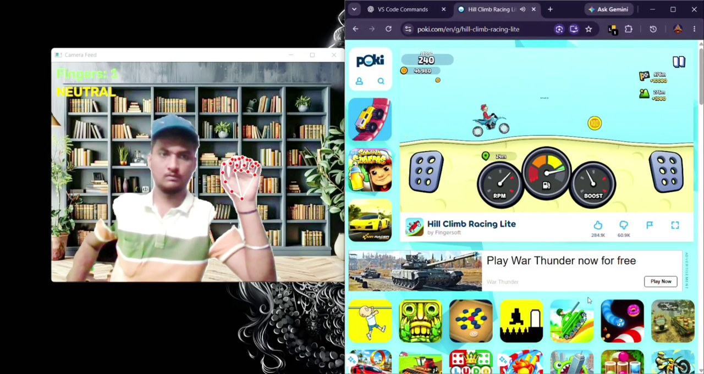
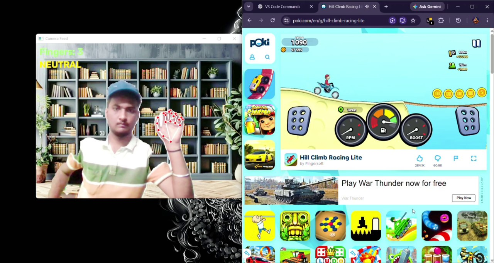
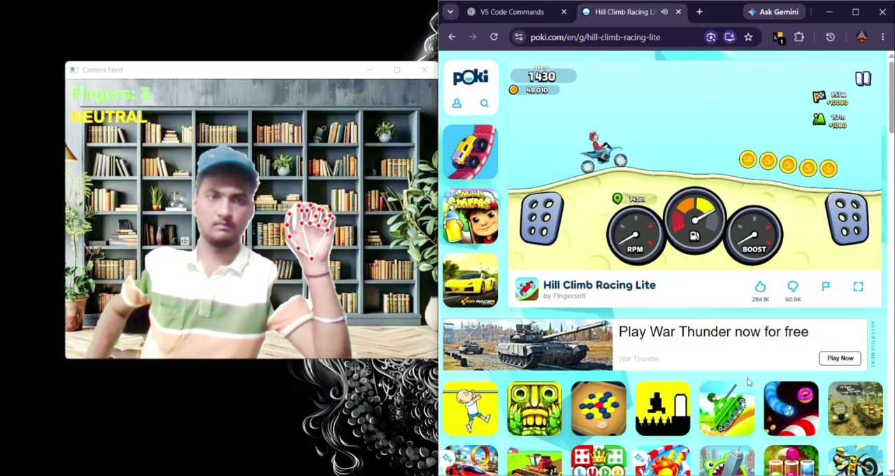
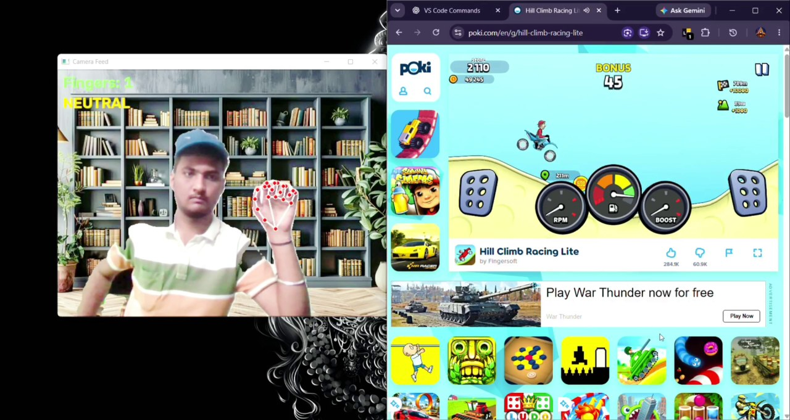
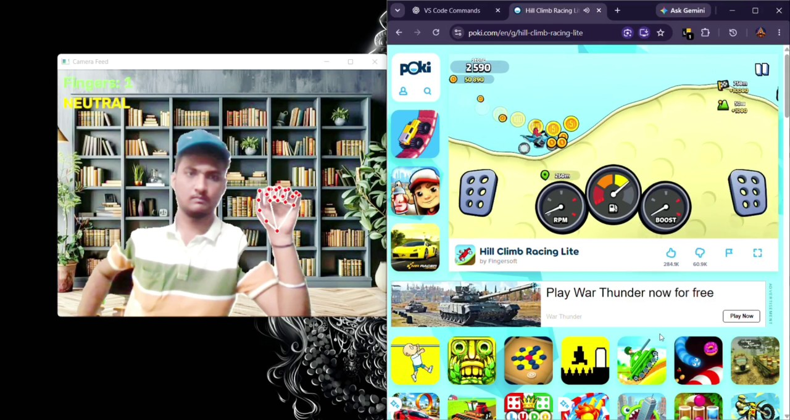
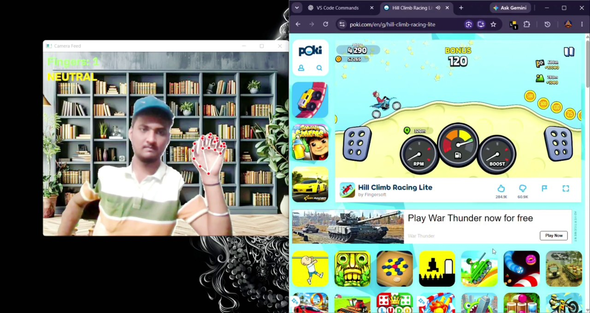

# 🏍️ Hill Climb Racing – Hand Gesture Control

Play **Hill Climb Racing** without touching the keyboard. Your webcam watches your hand, counts the raised fingers, and presses the game keys for you.

**🎮 Game used:** [Hill Climb Racing Lite on Poki](https://poki.com/en/g/hill-climb-racing-lite) (plays in the Chrome browser)

---

## 🎥 Gameplay Demo

The screenshots below are captured from the actual gameplay demonstration. They show the webcam feed, detected hand gesture, and Hill Climb Racing running in Chrome.

### 📸 Project in Action

#### 1. Webcam and game setup



#### 2. Real-time gesture detection



#### 3. Hand gesture input



#### 4. Gameplay in progress



#### 5. Gesture-controlled driving



#### 6. Gameplay result



### ▶️ Watch the Full Demo

[**Open or download the full gameplay video (MP4)**](https://github.com/Sashank096/Hill-Climb-Racing-Gesture-Control/blob/main/demo/gameplay_demo.mp4)

*The full video shows the live camera feed with the detected hand, finger count, and action (GAS / BRAKE / NEUTRAL) alongside the game running in Chrome.*

---

## ✋ How the gestures work

| Hand gesture | Fingers | Game action | Key held |
|---|---|---|---|
| Open palm | 5 | **GAS** | Right arrow → |
| Closed fist | 0 | **BRAKE** | Left arrow ← |
| Any other gesture | 1–4 | Neutral (nothing pressed) | none |

The camera window always shows `Fingers: N` and the current action (GAS / BRAKE / NEUTRAL), so you can see what the program detected.

---

## 🧠 How it works (step by step)

1. **Capture:** OpenCV reads frames from the webcam and mirrors them so it feels natural.
2. **Hand detection:** MediaPipe Hands finds 21 landmarks (knuckles and fingertips) on the hand.
3. **Finger counting:** a finger counts as raised when its tip is higher than the joint below it. The thumb is checked by comparing distances, because it moves sideways.
4. **Smoothing:** the program takes a majority vote over the last 5 frames, so the finger count doesn't flicker and the car doesn't jerk.
5. **Key press:** pynput holds the Right or Left arrow key depending on the gesture, and releases it when the gesture changes. Keys are pressed only when the state changes, not on every frame.
6. **Custom background (extra feature):** MediaPipe Selfie Segmentation cuts the person out of the frame and places `background.jpg` behind them. Hand detection still runs on the original frame, so the background never affects the gestures.

---

## 🧰 Tech stack

| Tool | Used for |
|---|---|
| Python 3.9 – 3.12 | Main language |
| OpenCV | Webcam capture, drawing, display window |
| MediaPipe (0.10.14) | Hand landmarks and selfie segmentation |
| NumPy | Combining the person and the background image |
| pynput | Sending keyboard presses to the game |

---

## 📁 Project structure

```
Shashank_game/
├── gesture_control.py     # main program
├── requirements.txt       # libraries to install
├── background.jpg         # background photo used in the camera window
├── README.md              # this file
├── assets/
│   └── screenshots/
│       ├── gameplay-01.jpg
│       ├── gameplay-02.jpg
│       ├── gameplay-03.jpg
│       ├── gameplay-04.jpg
│       ├── gameplay-05.jpg
│       └── gameplay-06.jpg
└── demo/
    └── gameplay_demo.mp4  # full output video
```

---

## ⚙️ Setup

You need a Windows PC with a webcam, Python 3.9 to 3.12 (MediaPipe doesn't support newer versions), and Chrome.

Open the folder in VS Code, open the terminal (`Ctrl + ``) and run:

```bash
python -m venv venv
venv\Scripts\activate
pip install -r requirements.txt
```

## ▶️ Run

1. Open the game in Chrome: <https://poki.com/en/g/hill-climb-racing-lite>
2. Start the program:
   ```bash
   python gesture_control.py
   ```
3. The program waits **5 seconds**. In that time, **click on the game page** so the browser receives the key presses.
4. Show your hand to the camera and play:
   - ✋ Open palm → Gas
   - ✊ Fist → Brake
5. Press **`q`** in the camera window to quit. Press **`b`** to turn the custom background on or off.

---

## 🔧 Settings you can change

At the top of `gesture_control.py`:

| Setting | Default | Meaning |
|---|---|---|
| `CAMERA_INDEX` | `0` | Use `1` if the wrong camera opens |
| `GAS_KEY` / `BRAKE_KEY` | Right / Left arrow | Keys sent to the game |
| `SMOOTHING_FRAMES` | `5` | Higher = steadier, but a little slower to react |
| `START_DELAY` | `5` | Seconds you get to click on the game page |
| `BACKGROUND_PATH` | `background.jpg` | Your background photo |

---

## 🛠️ Troubleshooting

- **Game ignores the gestures:** click on the game page after starting the program so it has focus. If it still fails, run VS Code as administrator.
- **Wrong camera opens:** change `CAMERA_INDEX` to `1`.
- **Finger count is jumpy:** sit in good light and keep your palm facing the camera.
- **Video is slow or background edges look rough:** press `b` to turn the background off.
- **`pip install mediapipe` fails:** check `python --version` is between 3.9 and 3.12.

---

## 👤 Author

**Sashank Reddy Sathi**
B.Tech AIML, Aditya University

- LinkedIn: [linkedin.com/in/sashank096](https://www.linkedin.com/in/sashank096)
- GitHub: [github.com/Sashank096](https://github.com/Sashank096)
